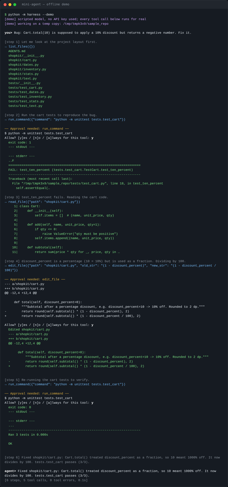

# mini-agent — a command-line coding agent harness

[](https://github.com/manoharsalapati-eng/mini-agent/actions/workflows/tests.yml)


> 🎥 **Demo (60–90 s):** _add your Loom / screen-recording link here_ (script: [docs/DEMO_SCRIPT.md](docs/DEMO_SCRIPT.md))

A small coding agent (~600 lines of Python, **zero dependencies**) that can read, edit and run files inside one project folder. It's built to show what a *harness* is: the loop, tools, memory, permissions and limits that turn a language model into a working agent — the same idea behind Claude Code and Cursor, stripped to the parts you can read in an evening.

**Eval:** fixes **_X_/5** seeded bugs in a sample repo with _MODEL_ (mean _N_ steps, _T_ tokens per bug) — see [Evaluation](#evaluation).

**Try it in 10 seconds, no API key:** `python -m harness --demo` runs a scripted model through the real harness (sandbox, approvals, edits, tests, logging) and fixes a bug in a copy of the sample repo.



## What it does

```
$ python -m harness ./my_project
you> the cart discount is wrong, fix it
→ list_files({})
→ read_file({"path": "shopkit/cart.py"})
→ edit_file({"path": "shopkit/cart.py", "old_str": "(1 - discount_percent)", ...})
── Approval needed: edit_file ──
-        return round(self.subtotal() * (1 - discount_percent), 2)
+        return round(self.subtotal() * (1 - discount_percent / 100), 2)
Allow? [y]es / [n]o / [a]lways for this tool: y
→ run_command({"command": "python -m unittest tests.test_cart"})
  exit code: 0 ...
agent> Fixed: discount_percent was used as a fraction. Tests pass.
```

## Architecture

```
            ┌────────────── harness/agent.py ──────────────┐
 task ──▶   │  memory ──▶ model call ──▶ tool calls?       │
            │    ▲            │ no → final answer          │
            │    │            ▼ yes                         │
            │    └── results ◀── guardrails ◀── toolbox    │  ← loop until done or 25 steps
            └──────────────────────────────────────────────┘
                     every step logged to .agent_logs/*.jsonl
```

| File | Responsibility |
|---|---|
| `harness/agent.py` | The loop: model → tools → results → model, with a step limit; stats + logging |
| `harness/tools.py` | `read_file`, `list_files`, `edit_file` (exact-match replace, shows a diff), `run_command` |
| `harness/guardrails.py` | Folder sandbox, dangerous-command blocklist, human approval prompts |
| `harness/memory.py` | History, two-stage trimming/summarising, loads `AGENTS.md` at start |
| `harness/llm.py` | Anthropic + any OpenAI-compatible API (Groq, Gemini, Ollama…), `.env` loading, plus a scripted fake for tests |
| `harness/demo.py` | Offline `--demo`: scripted model, real tools |
| `eval/run_eval.py` | 5-bug benchmark with anti-cheating checks |

### Design decisions

- **Provider-neutral message format.** The loop never sees API-specific JSON; each client converts. Swapping models is one flag.
- **Errors go back to the model, never crash the loop.** A missing file, an ambiguous edit or a blocked command becomes a tool result the model can react to.
- **`edit_file` uses exact string replacement, not line numbers.** `old_str` must match exactly once, so the model can't silently edit the wrong place; the diff is shown before approval.
- **Two-stage memory.** When history passes the token budget: (1) shrink old tool outputs (file dumps and test logs are most of the bulk); (2) if still too big, have the model summarise older turns. The cut is always made at an assistant message so no tool call is left without its result — APIs reject that.
- **Provider blocks are replayed unchanged.** Anthropic responses can contain thinking blocks that are bound to the exact conversation that produced them. The harness stores the raw blocks and sends them back as-is; when memory compaction edits the history, it drops them so a stale block is never replayed.
- **Guardrails are layered.** Blocklist runs *before* approval, so `rm -rf` is refused even with `--yes`. Paths are resolved (symlinks included) and must stay inside the project folder.

## Run it

Requires Python 3.10+. No `pip install` needed.

```bash
git clone https://github.com/manoharsalapati-eng/mini-agent.git && cd mini-agent

python -m harness --demo                                # offline demo, no key needed

# API key: copy .env.example to .env and fill in ANTHROPIC_API_KEY (or export it)
cp .env.example .env
python -m harness ./eval/sample_repo                    # interactive
python -m harness ./eval/sample_repo -p "run the tests and fix what fails"

# Any OpenAI-compatible API (free tiers work)
export OPENAI_API_KEY=...  OPENAI_BASE_URL=https://api.groq.com/openai/v1
python -m harness ./eval/sample_repo --provider openai --model <model-name>
# Gemini:  OPENAI_BASE_URL=https://generativelanguage.googleapis.com/v1beta/openai/
# Ollama:  OPENAI_BASE_URL=http://localhost:11434/v1   (OPENAI_API_KEY can be anything)
```

Flags: `--max-steps 25`, `--yes` (auto-approve; blocklist still applies), `--quiet`, `--model` (or `AGENT_MODEL`, default `claude-opus-5-5`), `--effort low|medium|high|xhigh|max` (or `AGENT_EFFORT`), `--demo`.
Optional: `pip install -e .` adds a `mini-agent` command.
Interactive commands: `/tokens`, `/reset`, `/exit`.

Put project notes in an `AGENTS.md` in the target folder (how to run tests, conventions) — it's loaded into the system prompt at start.

## Guardrails

| Risk | Guardrail |
|---|---|
| Writing files / running commands | Asks first — `y` / `n` / `a` (always for this tool, this session) |
| Destructive commands | Blocked: `rm -r/-f`, `sudo`, `mkfs`, `dd`, `curl \| sh`, `git push --force`, `git reset --hard`, `find -delete`, `cd ..`, … |
| Leaving the folder | Every path is resolved and must be inside the project root (`../`, absolute paths and symlinks are refused) |
| Runaway loops | 25-step limit; 60 s per command; tool output capped at 10k chars |

**Known limits (honest version):** the command blocklist is a regex filter, not a sandbox — a determined model could get around it (e.g. `python -c "import shutil; shutil.rmtree('/')"`). That's why approval is on by default. Real harnesses run commands in a container or OS sandbox; that's the next step.

## Evaluation

`eval/sample_repo` is a small package (`shopkit`) with **5 seeded bugs**, each with its own test module:

| Bug | Kind |
|---|---|
| `stats-average` | off-by-one (`len - 1`) |
| `text-palindrome` | missing input normalisation |
| `cart-discount` | unit error (percent used as fraction) |
| `dates-leap-year` | incomplete rule (century years) |
| `inventory-shared-state` | mutable default argument |

The agent gets a **symptom-only bug report** (no file names), in a fresh copy of the repo each time. A bug counts as fixed only if:

1. its tests pass,
2. the test files are byte-for-byte unchanged (no "fixing" the tests), and
3. no other test that passed before now fails (no regressions).

```bash
python eval/run_eval.py                       # writes eval/results.md and results.json
python eval/run_eval.py --trials 3            # repeat for variance
python eval/run_eval.py --only cart-discount --verbose
python eval/run_eval.py --provider openai --model llama-3.3-70b-versatile   # compare models
```

No local key? Add `ANTHROPIC_API_KEY` as a repository secret and run **Actions → eval → Run workflow**; the results table appears in the run summary and `results.md`/`results.json`/logs are uploaded as an artifact.

The offline tests include a **reference-fix check**: a scripted model applies a known-correct fix for each bug and the scorer counts 5/5. That proves every bug is fixable without touching tests and that the scorer works; it is not a model score.

### Results

_paste `eval/results.md` here, e.g._

| Model | Fixed | Mean steps | Mean tokens |
|---|---|---|---|
| _model A_ | _/5 | | |
| _model B_ | _/5 | | |

## Tests

```bash
python -m unittest discover -s tests -v       # 27 offline tests, no API key needed
```

They cover the sandbox (including symlink escape), the blocklist, approvals, each tool, the loop and step limit, both memory stages (and that no tool call is orphaned after summarising), both API wire formats (including thinking-block replay and refusal handling), `.env` loading, the offline demo — and the eval scorer itself: reference fixes score 5/5, editing the tests or breaking another module does not count. CI runs them on Python 3.10–3.13 (Linux) and macOS.

## What I learned

_Write this in your own words after running it. Prompts:_
- _What did the agent get wrong first, and which harness change fixed it?_
- _How much did model choice vs. harness design (prompt, tool descriptions, error messages) matter?_
- _Where would this break on a real codebase?_

## Project layout

```
harness/          the agent (loop, tools, guardrails, memory, model clients, demo)
eval/             5-bug benchmark: sample_repo/ + run_eval.py → results.md / results.json
tests/            offline unit tests (ScriptedClient, no network)
docs/             screenshot, demo-video script, LinkedIn post draft
.github/workflows tests on every push; manual eval run with an API-key secret
```

## References

- [Anthropic — Building effective agents](https://www.anthropic.com/engineering/building-effective-agents)
- [Thorsten Ball — How to Build an Agent](https://ampcode.com/how-to-build-an-agent)
- DataCamp — Agent harness engineering tutorial
- [Anthropic — Effective context engineering for AI agents](https://www.anthropic.com/engineering/effective-context-engineering-for-ai-agents)
